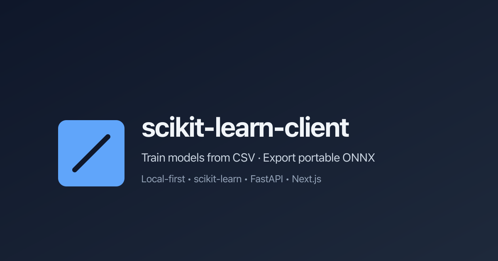

# scikit-learn-client (skl)

**Train supervised, semi-supervised, unsupervised, and offline reinforcement-learning models from CSV files. Export them as portable ONNX models — all on your own machine.**

scikit-learn-client (skl) is a local, full-stack training studio for tabular data. Upload a CSV with a header row, map feature columns to **X** and (when the task requires it) a label column to **Y**, or declare experience columns for offline reinforcement learning, choose a task — classification, regression, semi-supervised, clustering, anomaly detection, or reinforcement learning — and an algorithm from the curated catalogue. Train asynchronously and download a portable **ONNX** artefact. Everything runs locally via Docker Compose — no cloud account or infrastructure setup.

[📄 Documentation](docs/README.md) · [🚀 Quick Start](#get-started) · [🔍 See It In Action](#see-it-in-action) · [🧪 Try Algorithms](packages/frontend/src/app/algorithms/page.tsx)



## The Problem

Training a first machine-learning model still involves too many disconnected steps: cleaning a CSV, choosing an estimator, fitting, evaluating, and exporting something another runtime can load.

A useful local studio needs to make it possible to:

- Upload a CSV with a header row and inspect inferred columns.
- Map feature columns to **X** and, for supervised or semi-supervised tasks, the target to **Y**. For offline reinforcement learning, map state features to **X** and declare action/reward/next-state or episode columns.
- Choose a task — classification, regression, semi-supervised, clustering, anomaly detection, or reinforcement learning — and an algorithm.
- Train asynchronously with visible job status.
- Evaluate with task-appropriate metrics: a hold-out for supervised, semi-supervised, and offline RL jobs (episodes or transitions); in-sample cluster or anomaly scores for unsupervised jobs.
- Export **ONNX** every time, with optional pickle or joblib saves.
- Keep a local history of datasets, jobs, metrics, and artefact paths.
- Run the whole system with Docker Compose: frontend, backend, PostgreSQL.

skl brings these workflows together in one coherent application.

## The Solution

skl provides a focused, local-first workflow: upload a CSV, configure the mapping and algorithm, train, review metrics, and download ONNX. It supports the full learning spectrum — supervised, semi-supervised, unsupervised, and offline reinforcement learning — behind one upload → configure → train → export workflow, with ONNX as the single export contract. Everything runs locally via Docker Compose — no third-party services, no account creation.

## Features

Six task types ship today, all driven by the same import → inspect → map → train → export flow:

- **Classification** — map features **X** and a label **Y**, pick from 9 classifiers (logistic regression, random forest, gradient boosting, decision tree, extra trees, k-nearest neighbours, Gaussian naive Bayes, SVM, and a configurable multi-layer perceptron), and read a hold-out confusion matrix, per-class metrics, and feature importances.
- **Regression** — 10 regressors (linear, ridge, lasso, elastic net, k-nearest neighbours, decision tree, random forest, extra trees, SVR, and a configurable multi-layer perceptron) scored with RMSE, MAE, and R².
- **Semi-supervised learning** — self-training classification where only some rows carry a label; empty label cells are treated as unlabelled. The job reports labelled/unlabelled counts and iteration stats alongside the standard classification metrics.
- **Clustering** — KMeans, MiniBatchKMeans, or Gaussian Mixture with silhouette, Davies–Bouldin, and Calinski–Harabasz scores plus inertia or BIC.
- **Anomaly detection** — an IsolationForest with configurable contamination; scored by anomaly count/rate and score distribution.
- **Offline reinforcement learning** — Fitted Q-Iteration (`fitted_q_iteration`) turns a logged experience CSV (state features, action, reward, next-state or episode columns) into a Q-function, with no label column. Metrics include mean reward, mean Q, and TD-error statistics; the exported ONNX graph takes `(state, action)` and returns a scalar Q-value.

Every trained model — across all six task types — is exported to **ONNX**; pickle and joblib saves are optional extras for sklearn jobs.

### Neural networks

`mlp_classifier` and `mlp_regressor` are configurable multi-layer perceptrons for tabular data: depth and width (`hidden_layer_sizes`), `activation`, `solver`, L2 `alpha`, `learning_rate_init`, `max_iter`, `batch_size`, and `early_stopping` are all settable, with the fit seeded for reproducibility. They ride the same preprocessor and the same `skl2onnx` export path as every other entry — no extra dependency, no second ONNX surface.

## Key Benefits

- **Local-first & private** — Train on your own machine. Your data never leaves your environment.
- **From CSV to ONNX in minutes** — A guided wizard takes you from upload to a downloadable, portable `.onnx` artefact.
- **Honest, task-aware training** — Choose from a curated catalogue of scikit-learn classifiers, regressors, self-training, clustering, anomaly detection, and offline reinforcement-learning algorithms with transparent metrics.
- **Reproducible by design** — Every job records dataset fingerprint, column mapping, algorithm, hyperparameters, library versions, and task-specific metrics.
- **Developer-friendly** — FastAPI backend, Next.js UI, PostgreSQL metadata, and Docker Compose for a reproducible local topology.

## See It in Action


Or watch the full recorded walkthrough in [`demo/demo.md`](demo/demo.md) and [`demo/demo.mp4`](demo/demo.mp4).

## Get Started

The fastest way to run skl locally:

### Prerequisites

- [Docker](https://www.docker.com/) and [Docker Compose](https://docs.docker.com/compose/) v2

### Run the stack

```sh
cp .env.example .env
docker compose up --build
```

### Open the app

| Service  | URL                             |
| -------- | ------------------------------- |
| App      | <http://127.0.0.1:3000>         |
| API docs | <http://127.0.0.1:8000/docs>    |
| Health   | <http://127.0.0.1:8000/healthz> |

Stop and clean up:

```sh
docker compose down -v
```

For advanced local development (running backend/frontend on host), see [Technical Documentation](docs/README.md).

## Use Cases

- **Rapid prototyping** — Test ideas on small CSV datasets without setting up a full ML pipeline from scratch.
- **Teaching & learning** — Explore supervised, semi-supervised, unsupervised, and offline reinforcement learning end-to-end: data prep, training, evaluation, and ONNX export.
- **Model portability** — Export `.onnx` so trained models run in other runtimes and languages.
- **Local ML workflows** — Keep sensitive data on-device while experimenting with standard algorithms across the learning spectrum.

## Why This Project?

- **Focused scope** — Does one thing well: train models from CSV and export ONNX across supervised, semi-supervised, unsupervised, and offline reinforcement-learning tasks. No AutoML bloat.
- **Transparent** — Clear job lifecycle, per-metric explanations, and reproducibility metadata.
- **Local-first** — Runs entirely on your machine via Docker Compose; no vendor lock-in or external dependencies.
- **Production-minded demo** — Real FastAPI + Next.js + PostgreSQL implementation with tests, coverage gate, and e2e coverage.

## Project Status and Trust

- **Maturity:** Software demonstration (not intended for production AutoML or safety-critical use). All six task types are implemented, including offline reinforcement learning (Fitted Q-Iteration) added in Phase 11.
- **Catalogue:** 25 allow-listed algorithms — 9 classifiers, 10 regressors, 1 self-training classifier, 3 clustering models, 1 anomaly detector, and 1 offline reinforcement-learning model (`fitted_q_iteration`) — every one exported to ONNX.
- **License:** [MIT License](LICENSE) — see the `LICENSE` file for full terms.
- **Tech stack:** Next.js (App Router), TypeScript, Tailwind CSS, DaisyUI, FastAPI (Python 3.14.8), scikit-learn, ONNX, PostgreSQL 18, Docker Compose.
- **Testing:** Vitest + React Testing Library (80% coverage gate), Playwright e2e, pytest backend tests (162 passing, ~87% coverage, 80% gate).

## Community and Contributions

Contributions, bug reports, and feature suggestions are welcome. See existing resources:

- [README for Technical](docs/README.md) — architecture, API spec, data model, testing strategy
- [README for Backend](packages/backend/README.md)
- [README for Frontend](packages/frontend/README.md)

To report issues or propose changes, open an issue or pull request in this repository.

## Call to Action

**[Get Started](#get-started)** — Run skl locally in minutes and train your first model.

## License

This project is licensed under the [MIT License](LICENSE).
