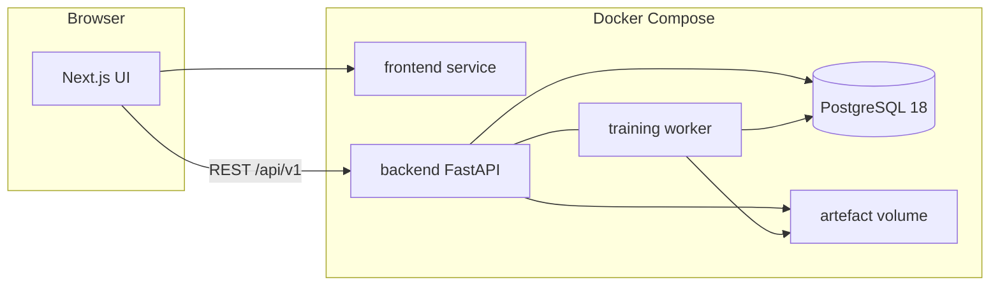

# scikit-learn-client (skl) — System Architecture

## 1. Purpose

This document describes the system architecture, component responsibilities, data flows, trust boundaries, and failure-recovery strategies for skl.

skl is a **local three-service system**: a Next.js frontend, a FastAPI training API with an in-process (or sibling) worker, and PostgreSQL. Files live on a Docker volume. There is no message broker in the MVP.

The primary architectural goals are:

- Clear separation between the interactive UI and long-running fit/export.
- ONNX as the required training contract.
- Task-aware training: supervised, semi-supervised, unsupervised, and offline reinforcement-learning strategies behind one worker.
- Explicit, parameterised persistence.
- Observable job state transitions.
- Reproducible local topology via Docker Compose.

## 2. Architectural Overview

The frontend talks only to the FastAPI origin (browser → backend; Next.js does not proxy training in production-like Compose — the browser uses `NEXT_PUBLIC_API_URL`). The backend owns validation, metadata, the worker, and filesystem I/O. PostgreSQL is the source of truth for jobs; the volume is the source of truth for bytes.

The main architectural rules are:

1. **Fit never runs in the request handler.** `POST /jobs` inserts a row and returns `202`.
2. **One worker, serial jobs** for MVP (`FOR UPDATE SKIP LOCKED`).
3. **Completed ⇒ ONNX exists.** Optional formats cannot mark success alone.
4. **No user code execution.** Algorithms are an allow-list in the backend.
5. **Local only.** No Kubernetes, no cloud object storage.
6. **One job workflow, six task strategies.** `classification`, `regression`, `semi_supervised`, `clustering`, `anomaly_detection`, and `reinforcement_learning` share upload, job, poll, and export contracts; only validation, splitting, fitting, and metrics differ.

### High-level architecture

Source diagram: [`01-high-level-architecture.mmd`](./04-architecture/mmd/01-high-level-architecture.mmd)



## 3. Architectural Style

### 3.1 Modular monolith (backend)

A single FastAPI application contains HTTP, the algorithm catalogue, and the worker loop. This is intentional: one laptop, one GPU/CPU budget, no Kafka.

Logical modules (packages), not extra processes:

- `api` — routers, Pydantic, error envelope
- `datasets` — upload, hash, preview
- `jobs` — lifecycle, idempotency keys
- `training` — preprocess, fit, metrics
- `export` — ONNX / pickle / joblib
- `db` — SQLAlchemy + Alembic
- `storage` — volume paths

A **second container** that runs the same image with `COMMAND=worker` is allowed if process isolation is desired; it must share the Postgres database and the volume. Compose still has exactly three _named_ services if worker is a replica of backend; alternatively `backend` runs both. **Decision:** MVP runs the worker inside the backend process (asyncio + thread pool for sklearn `fit`). P1 may split `worker` as its own Compose service using the same image.

### 3.2 Synchronous REST + polled jobs

Clients poll `GET /jobs/{id}`. No WebSockets in MVP.

### 3.3 Per-service data ownership (Compose)

| Service  | Owns                    | Does not own     |
| -------- | ----------------------- | ---------------- |
| frontend | UI, no business data    | Postgres, volume |
| backend  | API, worker, volume I/O | Browser state    |
| postgres | Relational metadata     | CSV/model bytes  |

## 4. Component Responsibilities

| Component       | Responsibility                                                    |
| --------------- | ----------------------------------------------------------------- |
| **Frontend**    | Upload, mapping, catalogue, poll, download. UX validation only.   |
| **Backend API** | Authz-free local API, validation, job insert, artefact streaming. |
| **Worker**      | Claim jobs, fit, evaluate, export, status updates.                |
| **PostgreSQL**  | datasets, jobs, metrics, artefacts, idempotency keys.             |
| **Volume**      | CSV and model files.                                              |

### 4.1 Frontend

Next.js App Router, TypeScript, Tailwind, DaisyUI. Routes: `/`, `/jobs/new`, `/jobs`, `/jobs/compare`, `/jobs/[jobId]`, `/algorithms`.

### 4.2 Backend API

FastAPI, Pydantic v2, uvicorn. Base path `/api/v1`. Health at `/healthz`, `/readyz`.

### 4.3 Worker

Claims `queued` jobs. CPU-bound `fit` runs in `asyncio.to_thread`. Updates status with optimistic locking (`WHERE status = expected`).

The worker is **bounded, interruptible, and retry-aware** (see
[`FEATURE-17`](./02-features/FEATURE-17-Reliable-Job-Execution.md)):

| Property        | Control                                    | Default   |
| --------------- | ------------------------------------------ | --------- |
| Concurrency     | `skl_MAX_CONCURRENT_JOBS`                  | `1`       |
| Per-attempt wall clock | `skl_JOB_TIMEOUT_SECONDS`          | `1800`    |
| Attempts        | `skl_JOB_MAX_ATTEMPTS`                     | `2`       |
| Backoff         | `skl_JOB_RETRY_BASE_SECONDS`, full jitter  | `2`       |
| Stale-job sweep | `skl_WORKER_STALE_SECONDS`                | `3600`    |

Jobs beyond the concurrency limit stay `queued`. A transient failure moves the job to `retrying`
and schedules the next attempt; a deterministic failure (invalid mapping, invalid label type,
insufficient labels, invalid hyperparameters) is never retried. Every attempt is bounded by the
wall-clock budget, and a timed-out attempt leaves no artefact behind.

The worker resolves a **task strategy** before fitting:

| Task                     | Strategy                                                                                                                                                                                                |
| ------------------------ | ------------------------------------------------------------------------------------------------------------------------------------------------------------------------------------------------------- |
| `classification`         | Stratified train/test split; fit on train; score hold-out.                                                                                                                                              |
| `regression`             | Train/test split; fit on train; score hold-out.                                                                                                                                                         |
| `semi_supervised`        | Split labelled rows; add all unlabelled rows to train with a `-1` sentinel; fit `SelfTrainingClassifier`; score labelled hold-out.                                                                      |
| `clustering`             | Fit preprocessor and estimator on all rows; score in-sample with silhouette, Davies–Bouldin, Calinski–Harabasz, and inertia/BIC.                                                                        |
| `anomaly_detection`      | Fit preprocessor and `IsolationForest` on all rows; score in-sample with `predict` and `decision_function`.                                                                                             |
| `reinforcement_learning` | Resolve transitions from `rlColumns` (explicit next state or next row in episode); split by episode or by transition; run FQI sweeps on training transitions; score with Bellman residuals on hold-out. |

### 4.4 PostgreSQL

Version 18. JSONB for hyperparameters, metrics, column lists, library versions. `label_column` is nullable and constrained by task type.

### 4.5 Volume

Mount `skl_data:/var/lib/skl`. Layout:

```
/var/lib/skl/datasets/{datasetId}.csv
/var/lib/skl/artefacts/{jobId}/{jobId}.onnx
/var/lib/skl/artefacts/{jobId}/{jobId}.pkl   # optional
/var/lib/skl/artefacts/{jobId}/{jobId}.joblib # optional
```

### 4.6 Configuration

All environment variables are read **once**, at process start, by a single settings module
(`packages/backend/src/config.py`). No module calls `os.environ` directly, and no module parses
an environment variable on a hot path.

The module exposes typed, validated settings with documented defaults:

| Group      | Settings                                                                       |
| ---------- | ------------------------------------------------------------------------------ |
| Database   | `DATABASE_URL`                                                                 |
| Storage    | `skl_DATA_DIR`, `skl_MAX_UPLOAD_MB`                                            |
| HTTP       | `skl_CORS_ORIGINS`, `skl_CORS_ALLOW_CREDENTIALS`, `skl_ENABLE_INTERACTIVE_DOCS` |
| Worker     | `skl_MAX_CONCURRENT_JOBS`, `skl_JOB_TIMEOUT_SECONDS`, `skl_JOB_MAX_ATTEMPTS`, `skl_JOB_RETRY_BASE_SECONDS`, `skl_WORKER_STALE_SECONDS` |
| Logging    | `skl_LOG_LEVEL`                                                                |

An invalid value falls back to the documented default and logs one warning at startup naming the
variable and the value used (NFR-054). The authoritative list of variables, defaults, and
statuses is [`11-deployment/environment-variables.md`](./11-deployment/environment-variables.md).

**CORS.** The allow-list comes from `skl_CORS_ORIGINS` (comma-separated), defaulting to
`http://localhost:3000,http://127.0.0.1:3000`. `*` is rejected while
`skl_CORS_ALLOW_CREDENTIALS` is enabled. This replaces the hard-coded list that previously
lived in `main.py`, so the origin policy is configurable without touching code and is testable
from a single module.

## 5. Request Lifecycle

### 5.1 Upload

See [`02-dataset-upload-flow.mmd`](./04-architecture/mmd/02-dataset-upload-flow.mmd).

1. Browser `POST /api/v1/datasets`.
2. API checks size, then the declared content type and the file extension, then **sniffs the
   bytes** — a file whose header matches a known binary format (ZIP, gzip, PNG, PDF, ELF) is
   rejected with `UNSUPPORTED_FILE_TYPE` even when it is called `.csv`.
3. The bytes are decoded as UTF-8 (a BOM is permitted) and parsed as delimited text; a parse
   failure returns `MALFORMED_CSV`.
4. The header must be non-empty and contain no empty or duplicate column names.
5. Stream to temp file, hash, parse preview, compute the dataset insights profile, atomic move,
   insert the `datasets` and `dataset_insights` rows, `201`.

### 5.2 Train

See [`03-training-job-flow.mmd`](./04-architecture/mmd/03-training-job-flow.mmd).

1. `POST /jobs` validates catalogue, mapping, task label rules, and hyperparameter ranges.
2. Insert `queued`, `202`.
3. Worker: validating → training → evaluating → exporting → completed, using the task strategy from §4.3.
4. Frontend polls every 1 s.

## 6. Preprocessing and training contract

A sklearn `Pipeline` is the unit of export:

1. `ColumnTransformer`: numeric `SimpleImputer` + `StandardScaler`; categorical `SimpleImputer(most_frequent)` + `OneHotEncoder(handle_unknown=ignore)`.
2. Estimator from the catalogue.
3. Entire pipeline converted to ONNX so inference does not require the original CSV schema code.

### 6.1 Label and split rules

- **Classification / regression:** Y is required; the split is a random hold-out (default 0.2, seed 42), stratified for classification.
- **Semi-supervised:** Y is required but may contain empty cells. Empty, whitespace-only, `NaN`, and `null` cells are unlabelled. Only labelled rows are split into train/test; every unlabelled row joins the training features with a `-1` sentinel. The preprocessor is fitted on all training rows so unlabelled rows contribute to encoding. At least two classes, 10 labelled rows, and 2 labelled rows per class are required.
- **Clustering / anomaly detection:** no label column. The preprocessor and estimator fit on all rows; evaluation is in-sample because there are no labels to hold out. `splitRatio` is ignored.
- **Reinforcement learning:** no label column. `rlColumns` define `actionColumn`, `rewardColumn`, and either `nextStateColumns` or `episodeColumn` (optional `doneColumn`). Transitions are resolved from the CSV; when an episode column exists, whole episodes go to train or hold-out (default 0.2 of episodes, seed 42), otherwise transitions are split randomly. The preprocessor is fitted on the training side only. `splitRatio` records the requested split but the unit is episodes or transitions as documented. `rl_columns` is stored on the job and validated as specified in [`FEATURE-11`](./02-features/FEATURE-11-Reinforcement-Learning.md).

### 6.2 Export contract

- **Supervised:** the fitted pipeline is exported directly.
- **Neural nets (MLP):** `mlp_classifier` and `mlp_regressor` are ordinary scikit-learn estimators, so the fitted pipeline (preprocessor + MLP) is exported directly through `skl2onnx` like any other supervised entry — no framework-specific exporter and no two-file exception.
- **Semi-supervised:** `skl2onnx` has no converter for `SelfTrainingClassifier`. Export a pipeline of the fitted preprocessor plus `SelfTrainingClassifier.estimator_` (the fitted base estimator). Self-training changes only the training labels, so predictions match the wrapper. `pkl`/`joblib` keep the wrapper.
- **Clustering / anomaly detection:** the fitted preprocessor plus estimator is exported directly.
- **Reinforcement learning:** the fitted preprocessor plus Q-function regressor (built from Bellman targets during FQI sweeps) is exported directly. The graph takes the state features in `featureColumns` order followed by the one-hot action block in the recorded `actions` order; the policy `π(s)=argmax_a Q(s,a)` is a documented consumer-side rule, not in the graph.
- **Opset:** the exporter pins the default domain to 15 and `ai.onnx.ml` to **3**. IsolationForest otherwise emits ML-domain v4 operators that the pinned ONNX Runtime rejects.
- **Allow-list gate:** an estimator without a verified converter must not enter the catalogue. CI converts every entry and compares predictions with sklearn.

Every shipped model uses a single `skl2onnx` export path, so there is no framework-specific exporter, no combined-graph stitching, and no two-file exception. The neural-net offering is configurable tabular scikit-learn MLPs ([`08-tech-stack` §5.4](./08-tech-stack.md#54-neural-networks-tabular-mlps)).

## 7. Concurrency

- One worker claims one job.
- Additional `queued` jobs wait.
- Job status updates use `UPDATE jobs SET status=$new WHERE id=$id AND status=$from`.
- The number of jobs executing at the same time is bounded by `skl_MAX_CONCURRENT_JOBS`
  (default **1**, preserving the serial MVP behaviour). Jobs beyond the limit stay `queued`, and
  the API reports their queue position.
- A job attempt is bounded by `skl_JOB_TIMEOUT_SECONDS` (default **1800**). On expiry the
  attempt is cancelled, any partially written artefact is removed, and the job is recorded
  `failed` with `JOB_TIMEOUT`.
- A transient failure is retried up to `skl_JOB_MAX_ATTEMPTS` times (default **2**) with
  exponential backoff and full jitter based on `skl_JOB_RETRY_BASE_SECONDS` (default **2**).
  Between attempts the job reports the non-terminal status `retrying` and an `nextAttemptAt`
  timestamp. Deterministic failures are never retried.

## 8. Failure recovery

| Failure                               | Behaviour                                                                                                                                                                           |
| ------------------------------------- | ----------------------------------------------------------------------------------------------------------------------------------------------------------------------------------- |
| Postgres down                         | `/readyz` 503; UI network-error                                                                                                                                                     |
| Disk full                             | job `failed` `EXPORT_FAILED`                                                                                                                                                        |
| Process kill during fit               | on startup, jobs in `validating`/`training`/`evaluating`/`exporting` older than `skl_WORKER_STALE_SECONDS` (default 3600) → `failed` `WORKER_INTERRUPTED`                               |
| ONNX export exception                 | `failed` `EXPORT_FAILED`; no completed status                                                                                                                                       |
| Attempt exceeds the wall-clock budget | `failed` `JOB_TIMEOUT`; no artefact row, no artefact file                                                                                                                            |
| Transient environment failure         | job `retrying` → backoff → `queued` → next attempt; exhausted budget → `failed` `JOB_RETRY_EXHAUSTED`                                                                                   |
| Deterministic fit/validation failure  | `failed` on the first attempt; never retried                                                                                                                                         |
| Missing or unexpected label column    | job create `400 INVALID_COLUMN_MAP`; no job row                                                                                                                                     |
| Insufficient labelled rows            | job create `400 INSUFFICIENT_LABELS`; no job row                                                                                                                                    |
| Invalid cluster count / contamination | job create `400 INVALID_HYPERPARAMETERS`; no job row                                                                                                                                |
| Estimator lacks an ONNX converter     | rejected at catalogue integrity time; never offered in the UI                                                                                                                       |
| Missing/invalid RL experience mapping | job create `400 INVALID_COLUMN_MAP`; non-numeric reward or inconsistent experience columns → `INVALID_LABEL_TYPE`; out-of-range FQI hyperparameters → `400 INVALID_HYPERPARAMETERS` |
| Non-CSV upload                        | `400 UNSUPPORTED_FILE_TYPE` (extension, content type, or sniffed bytes)                                                                                                            |
| Unparseable CSV bytes                 | `400 MALFORMED_CSV`                                                                                                                                                                 |

## 9. Security boundaries

- Browser is untrusted: all validation is server-side.
- Volume is not served by nginx/Next static files.
- Downloads go through FastAPI after a DB lookup.
- No pickle load of user uploads.
- CORS allow-list: the frontend origin, read from `skl_CORS_ORIGINS` by the central settings
  module (§4.6). `*` is rejected while credentialed requests are enabled.
- Uploads are validated by extension, content type, **and** sniffed bytes, so a mislabelled
  binary never reaches the CSV parser.

Local single-user: no JWT in MVP. Binding Compose ports to `127.0.0.1` is required.

### 9.1 Interactive API reference

The backend serves `/docs` (Swagger UI), `/redoc`, and `/openapi.json`. These paths are outside
the `/api/v1` base path and are not part of the training contract. They are enabled by default
and can be turned off with `skl_ENABLE_INTERACTIVE_DOCS=false`. The committed schema
(`docs/06-api-specification/backend/openapi.yaml`) is regenerated from the code and checked for
drift in CI.

## 10. Scalability considerations

Vertical only. If queue depth is a problem, split worker Compose service (same image). Do not add Kafka until a documented need exists.

## 11. Technology mapping

See [`08-tech-stack.md`](08-tech-stack.md).

## 12. Coding conventions

### 12.1 File size limits

To maintain code readability and maintainability, source files should not exceed **200 lines**. A 10% margin of error (up to 220 lines) is acceptable for reasonable cases. When a file approaches this limit, consider splitting it into smaller, focused modules.

For frontend-specific coding conventions, see [`docs/08-tech-stack/frontend/README.md`](08-tech-stack/frontend/README.md).

## Cross-references

- Data model: [`05-data-model.md`](05-data-model.md)
- API: [`06-api-specification.md`](06-api-specification.md)
- Deployment: [`11-deployment.md`](11-deployment.md)
